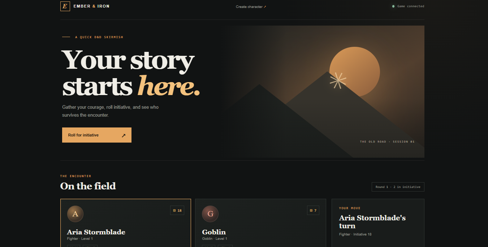

# D&D Microservices

Phase 1: everything runs locally as separate processes. Docker and orchestration come next.

| Service   | Port | Job                                                   |
|-----------|------|-------------------------------------------------------|
| gateway   | 8000 | Single entry point, routes to the services below      |
| dice      | 8001 | Rolls dice (`2d6+3`, `4d6kh3`, d20 advantage)          |
| character | 8002 | Character / monster sheets (in-memory)                |
| combat    | 8003 | Initiative and attacks; calls dice + character        |

Services find each other through env vars (`DICE_URL`, `CHARACTER_URL`, `COMBAT_URL`),
defaulting to localhost, so the same code works in Docker later by changing only these.

## Run

    pip install -r requirements.txt
    ./run_local.sh
    pytest tests -q

On Windows PowerShell, start each service in a separate terminal from the project
folder:

    python -m uvicorn main:app --app-dir services\dice --port 8001
    python -m uvicorn main:app --app-dir services\character --port 8002
    python -m uvicorn main:app --app-dir services\combat --port 8003
    python -m uvicorn main:app --app-dir services\gateway --port 8000

Open **http://localhost:8000/** to play in the browser. The game page lets you
create characters, roll animated initiative and attacks, take turns, choose a
target, roll with advantage or disadvantage, defend for +2 AC against the next
attack, and reset the seeded Goblin's HP. Interactive API docs are also available at
http://localhost:8000/docs (or on each service at http://localhost:800X/docs).
Open the game through this address, not by double-clicking
`frontend/index.html`, so its requests can connect to the API.

## Local Kubernetes HTTPS with Ingress

The NGINX Ingress routes `https://dnd.example.com/` to the gateway. The
frontend sends API requests under `/api/v1/`, such as
`/api/v1/characters` and `/api/v1/combat/initiative`; the gateway forwards
those to the internal services.

On Windows, install and initialize [mkcert](https://github.com/FiloSottile/mkcert)
as the same user account that runs your browser. This creates a local
certificate authority trusted by Windows and Chrome:

    winget install --id FiloSottile.Mkcert -e
    mkcert -install

Create a certificate and key in a local directory, then store them in the
Kubernetes TLS Secret:

    $certDir = "$env:USERPROFILE\.dnd-local-certs"
    New-Item -ItemType Directory -Force $certDir | Out-Null
    mkcert -cert-file "$certDir\dnd.example.com.pem" -key-file "$certDir\dnd.example.com-key.pem" dnd.example.com
    kubectl create secret tls dnd-local-tls --cert="$certDir\dnd.example.com.pem" --key="$certDir\dnd.example.com-key.pem" --dry-run=client -o yaml | kubectl apply -f -

Add `127.0.0.1 dnd.example.com` to the Windows hosts file at
`C:\Windows\System32\drivers\etc\hosts` using an administrator editor. If
Windows does not resolve it immediately, run `ipconfig /flushdns`.

Build the updated gateway image and apply the Kubernetes manifests:

    docker build -f services/gateway/Dockerfile -t dnd-gateway .
    kubectl apply -f .\k8s\deployment.yml
    kubectl apply -f .\k8s\service.yml
    kubectl apply -f .\k8s\ingress.yml
    kubectl rollout status deployment/dnd-gateway

Docker Desktop does not directly publish the Ingress controller to Windows, so
forward its HTTPS port in a separate PowerShell terminal and leave it running:

    kubectl port-forward -n ingress-nginx service/ingress-nginx-controller 443:443

Open **https://dnd.example.com/** with the port-forward active. Verify from
another terminal with:

    curl.exe https://dnd.example.com/

If the hostname has not been added to the hosts file yet, test routing without
changing DNS with:

    curl.exe --resolve dnd.example.com:443:127.0.0.1 https://dnd.example.com/

If curl reports `SEC_E_UNTRUSTED_ROOT`, run `mkcert -install` as the same
Windows user running curl and Chrome, regenerate the certificate above, and
reapply the TLS Secret command. Do not use `curl -k` as the permanent fix; it
skips certificate verification. Keep the certificate and private key files
out of source control; the TLS Secret stores the certificate in Kubernetes.

## Gateway Docker image

Build from the repository root so Docker can copy both the gateway code and
frontend files:

    docker build -f services/gateway/Dockerfile -t dnd-gateway .

The gateway expects the other containers to be reachable by the names `dice`,
`character`, and `combat` on the same Docker network. Its container listens on
port 8000; publish it on an available host port (for example, `-p 8111:8000`
if port 8000 is already in use) and open that host port in your browser. Override
`DICE_URL`, `CHARACTER_URL`, or `COMBAT_URL` if your container names or ports
differ.

## Run with Docker Compose

From the repository root, build and start all services:

    docker compose up --build

Open **http://localhost:8111/**. To use a different host port, set
`GATEWAY_PORT` (for example, `$env:GATEWAY_PORT=8000` in PowerShell) before
starting Compose. Stop the services with `Ctrl+C`, or run
`docker compose down` in another terminal.

## Try it (through the gateway)

    curl -X POST localhost:8000/dice/roll -H 'content-type: application/json' -d '{"notation":"4d6kh3"}'
    curl -X POST localhost:8000/dice/d20  -H 'content-type: application/json' -d '{"modifier":5,"advantage":true}'
    curl localhost:8000/characters
    curl -X POST localhost:8000/combat/initiative -H 'content-type: application/json' -d '{"combatant_ids":["aria","goblin"]}'
    curl -X POST localhost:8000/combat/attack -H 'content-type: application/json' -d '{"attacker_id":"aria","target_id":"goblin"}'

Seeded combatants: `aria` (Fighter, AC 16) and `goblin` (AC 15, 7 HP).
Open **Create character** from the game header to add another player or monster.
Characters are in-memory and appear in initiative the next time an encounter starts.
Reset HP with `POST /characters/goblin/reset`.

## Dice notation

`NdM`, optional keep highest/lowest (`kh`/`kl`), optional modifier: `d20`, `2d6+3`, `4d6kh3`, `1d20-1`.
Limits: 1-100 dice, 2-1000 sides. Nat 20 / nat 1 are flagged on single d20 rolls.

# dnd
lets play

